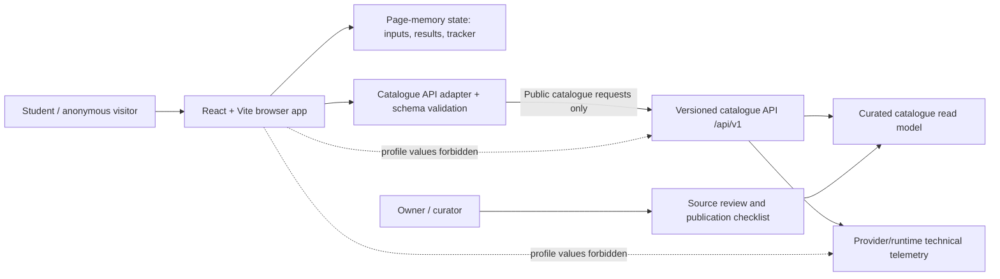

# StudyPath SA — System Architecture

**Status:** Architecture baseline proposal for review; not yet approved for implementation.  
**Phase:** 3 — Architecture. **Baseline date:** 2026-10-16.  
**Source of truth:** approved PRD, `docs/product/REQUIREMENTS.md`, scope reconciliation D-044–D-047, open questions, and current decision records.  
**Important:** This design does not assert that application code, cloud resources, CI/CD, or deployments exist.

## 1. Purpose and scope

Provide an API-first architecture for a bounded, synthetic-data MVP that helps South African Grade 11–12 learners and recent matric graduates explore plausible study pathways, understand eligibility uncertainty, inspect official sources, and identify next steps.

The current D-047 demo slice is a local browser application using synthetic, curated catalogue data. It has no authentication, real learner data, profile persistence, uploads, cloud sync, Azure provisioning, or deployment. Intended API-first runtime and the D-046 authenticated feature extension are later, gated stages—not permission to implement those capabilities now.

### Requirement drivers
- `REQ-EXP-001`, `REQ-CAT-001`, `REQ-MAT-001`, `REQ-ALT-001`, `REQ-DET-001`: anonymous exploration, curated catalogue, explainable deterministic eligibility, alternatives only when verified, source-backed details.
- `REQ-FUND-001`, `REQ-APP-001`: P1 funding matching and manual tracker; tracker remains in page memory only.
- `REQ-PRV-001`, `NFR-PRV-001`, `NFR-SEC-001`: data minimisation and no profile transmission/storage/telemetry.
- `REQ-UX-001`, `NFR-ACC-001`, `NFR-REL-001`, `NFR-DATA-001`, `NFR-PERF-001`: accessible, resilient, evidence-grounded behavior.
- Budget ceiling: R100/month total; no resource provisioning before resource-specific cost and access review.

## 2. System context and component architecture

This is a logical design. The diagram does not imply the API, database, hosting, or monitoring has been selected, provisioned, or verified.

### Browser application boundary
- React/Vite presents the learner journey, validation, result explanations, source links, empty/error states, and reset behavior.
- Anonymous marks, subjects, interests, derived results, and manual tracker entries exist only in page memory. Do not write them to URLs, browser storage, cookies, analytics, application logs, error telemetry, or API requests.
- The browser evaluates anonymous matching deterministically against public catalogue records. Frontend validation improves usability but does not turn incomplete source data into an eligibility decision.
- Validate incoming catalogue payloads at runtime; reject malformed or unsupported schema versions and show a recoverable error rather than fabricating fallback records.

### Catalogue API boundary (intended later runtime)
- Base path: `/api/v1`. Public, read-only catalogue operations only in the initial API tier.
- Responses include stable identifiers, catalogue/schema version, qualification or funding data, source provenance, applicable cycle, verification timestamp, and publication/freshness state.
- No request may contain learner marks, subject results, interests, profile fields, recommendation results, or tracker entries in this tier.
- Exact endpoints, schemas, caching, timeout, retry, CORS, rate-limit, hosting composition, and service choice remain unfrozen until the API contract and cost/security review are approved.

### Curator and publication boundary
- A human curator transcribes and verifies a bounded pilot of 6–8 programme records, prioritising Gauteng, and 3–5 funding records only when verified source data is available.
- Publication requires official or authoritative source URL, source/provider name, applicable admission/funding cycle, date checked, catalogue version, evidence for every rule, completeness assessment, and curator sign-off.
- Missing or contradictory rule evidence means do not publish a definitive eligibility rule. Never invent alternatives; publish relationships only when source evidence supports them.

### Deferred authenticated boundary
D-046 records intended future scope for authenticated server-side matching, saved pathways, pathway comparison, saved funding opportunities, and a derived dashboard. This is not part of the D-047 local demo. No implementation until Q-018/Q-020 and API, consent/lifecycle, identity, authorization, isolation, privacy, tests, cost and operations gates are resolved. Academic-profile persistence requires explicit opt-in; login alone is not consent. The tracker remains memory-only and is not synced.

## 3. Request and data flows

### Anonymous discovery
1. Load the browser application and disclose that results use a bounded, curated catalogue.
2. Learner enters stage and valid subject/mark pairs; optional interest, intended location, and study mode are held in memory.
3. Client validates inputs and fetches public catalogue data without learner-specific fields.
4. Client checks catalogue schema, source metadata, cycle, freshness and rule completeness.
5. Deterministic evaluator classifies each candidate as `ELIGIBLE`, `NOT_ELIGIBLE`, or `UNKNOWN`. Unsupported/missing requirements cannot produce `ELIGIBLE`.
6. UI shows reasons, source links, limits and next steps. Alternative pathways appear only when an explicit verified relationship exists.
7. Reset clears in-memory inputs/results/tracker. Reload or exit may discard them.

### Funding and manual tracker (P1)
- Funding matching uses only fields explicitly allowed by the approved requirements and avoids requesting national ID, household income, bank details, or sensitive financial/family documents.
- Show provider eligibility, deadline, required documents and official source only where verified; unknown criteria are clearly disclosed.
- A learner may add an opportunity to a page-memory tracker. Entries and status/notes/deadlines are not sent to a server and are not durable across reloads.

### Catalogue publication
Official source → curator extraction → schema and source validation → eligibility-rule completeness review → cycle/freshness review → versioned record → curator sign-off → publication. AI extraction/crawling is not part of the current MVP and cannot be an authority.

### Failure behavior
- API unavailable, timeout, malformed response, stale catalogue, missing source, or unsupported schema: show a clear retry/empty/error state; do not use invented sample data as if authoritative.
- Missing student subject/mark or incomplete qualification rules: `UNKNOWN`, with a specific reason.
- No verified relationship: omit the alternative or state no verified alternative is available.
- Invalid form values: inline accessible validation; do not send the profile.
- Reset should be deterministic and leave no learner values in browser persistence or telemetry.

## 4. Data architecture overview

The current demo should use version-controlled synthetic fixtures and explicit schemas; it does not need a database. The later API-first runtime may use a catalogue read model, but the database technology is not approved merely by the broad specification. PostgreSQL must not be introduced until its necessity, service cost, operations, migration and security are reviewed.

Core catalogue concepts: Institution, Qualification/Programme, Subject, Qualification Requirement, Funding Provider, Funding Opportunity, Funding Requirement, Source Record, Catalogue Version, and verified Pathway Relationship. See `DATA-MODEL.md` for fields, keys, constraints, indexes, lifecycle and ownership.

Learner profile, recommendation history, saved pathways, saved funding and personal dashboard persistence belong to a later authenticated tier and require separate approved data lifecycle/consent contracts. Manual tracker records are ephemeral browser state only.

## 5. Security and privacy architecture

- Anonymous-first; no account required for the current demo.
- Synthetic data only. Never use actual learner profiles in local development, tests, CI, staging or demo.
- No learner inputs/results/tracker data in API requests, URLs, browser storage, analytics, application logs or error telemetry.
- Catalogue API is public read-only; no secrets in browser bundles. Restrict catalogue writes to the reviewed publication process.
- Validate all request/response schemas and catalogue content; encode output and use safe rendering for untrusted source descriptions.
- HTTPS and managed identities/secrets are relevant only if a cloud runtime is later approved. Do not implement authentication by inventing provider configuration.
- Review dependency behavior, hosting/provider access logs, request metadata, retention, privacy notice, deletion/incident handling and applicable legal obligations before public use.
- Future authenticated features require verified token issuer/audience/signature/expiry, server-side authorization, ownership checks on every record, cross-user isolation tests, explicit opt-in for academic profile persistence, and no profile payloads in logs or URLs.

Full boundaries and threats: `SECURITY-ARCHITECTURE.md`.

## 6. Environments and infrastructure

| Environment | Current status / allowed use | Data | Cloud |
|---|---|---|---|
| Local development | Current target for D-047 demo | Synthetic fixtures only | No Azure resource required |
| Automated test/CI | Planned; verify workflow before relying on it | Synthetic fixtures only | No real learner data or production credentials |
| Staging | Future, only if approved | Synthetic data only | Not provisioned/verified |
| Production/public demo | Not deployed or approved | Real learner data prohibited until privacy/security review and implementation evidence | No provisioning until resource/cost/access approval |

Documented candidates include Static Web Apps, Azure Functions and optionally API Management. PostgreSQL, Blob Storage, Entra External ID, Azure OpenAI and Document Intelligence are not approved for the initial journey. Terraform and GitHub Actions are the documented IaC/CI direction, but their actual repository presence and execution must be verified before claiming implementation.

See `INFRASTRUCTURE.md` for the component inventory, environment isolation, deployment, recovery and cost controls.

## 7. Observability

The current local demo must avoid learner-data telemetry. Only minimal technical diagnostics may be considered after confirming the actual tooling does not collect form values, DOM contents, URLs containing inputs, or request bodies. No analytics product or cloud monitoring resource is assumed to exist.

If a runtime is later approved, use structured logs with request/correlation ID, operation, status, duration, catalogue version and dependency outcome only. Never log profile fields, marks, recommendations, tracker notes, access tokens, or uploaded content. Metrics should cover API availability/latency/error rate, catalogue freshness/provenance completeness, unknown eligibility rate, matching false-positive test results, and CI/deployment health. Alert thresholds and SLOs require approval; none are claimed here.

See `OBSERVABILITY.md`.

## 8. Scalability, availability and performance

- Scale catalogue content by adding verified records and providers without changing the core entity model; avoid national-coverage claims until coverage is demonstrated.
- Stateless read-only catalogue APIs and static/browser delivery are horizontally scalable in principle, but actual limits depend on the chosen provider/plan and are not yet verified.
- The client evaluator should process the bounded pilot synchronously; measure performance on a documented low-end mobile/browser test profile before defining numeric targets.
- Do not promise availability or recovery objectives until service composition, budget, backups and operational ownership are approved.
- Cache policy must respect admission cycle, deadlines and source freshness. Stale/expired data must be visibly flagged or withheld, not silently served as current.

## 9. Recovery and rollback

- Catalogue changes are versioned and reviewed; retain the previous approved version so a bad publication can be rolled back.
- A failed frontend release must be reverted to the last known-good build using the host's supported deployment mechanism once hosting is selected.
- If a later API is unavailable, the UI shows an explicit recoverable failure. Do not silently switch to unverified embedded records.
- Database backup/restore is not applicable to the local demo. If a database is approved later, define backup frequency, PITR/retention, migration rollback/forward-fix and conduct a restore test before release.
- Recovery owner, RTO/RPO, incident contacts and production rollback mechanics must be approved before public deployment.

## 10. Cost and technology constraints

Hard cap: R100/month total. Prefer local/free-tier services. Include hosting, API gateway, functions, logs/monitoring, storage, database, egress, domain, tax/currency and overage exposure in the cost estimate. A zero-cost calculator estimate is not proof of a zero bill. No provisioning before the exact billable resource list, quotas, region availability, identity/permissions, cost alerts and rollback responsibility are reviewed.

## 11. Decisions and architecture readiness

ADRs are indexed in `ADR-INDEX.md`; proposed records cover API-first boundary, catalogue/provenance, privacy, infrastructure/cost and observability.

### Must be frozen before implementation
1. Confirm the current D-047 demo scope and exact accepted requirement IDs for the implementation slice.
2. Approve API routes/schemas/versioning/error/caching/CORS/timeout behavior before building API consumers.
3. Approve subject vocabulary, catalogue schema, requirement operators/composition, rule completeness, and golden-set cases.
4. Approve eligibility precedence when requirements conflict, are stale, cycle-specific, or use unsupported points systems.
5. Approve publication workflow, verification evidence, freshness policy, and exact pilot records/relationships.
6. Verify whether existing repository workflows/tests can be run and define required CI checks.
7. For any cloud deployment: freeze provider/service composition, region, access, cost, secrets, networking, quotas and rollback.
8. Before any real learner data/authenticated tier: freeze identity provider and flow, authorization/ownership model, consent and profile lifecycle, privacy notice, retention/deletion, telemetry, threat model and cross-user isolation tests.
9. Define operational ownership, alerts, recovery targets and release evidence.

**Gate status: NOT YET ARCHITECTURE READY.** The architecture direction is documented, but material runtime/contract/cost/privacy decisions remain open and the required companion documents need review. Do not begin dependent implementation until the architecture and ADRs are explicitly accepted.
